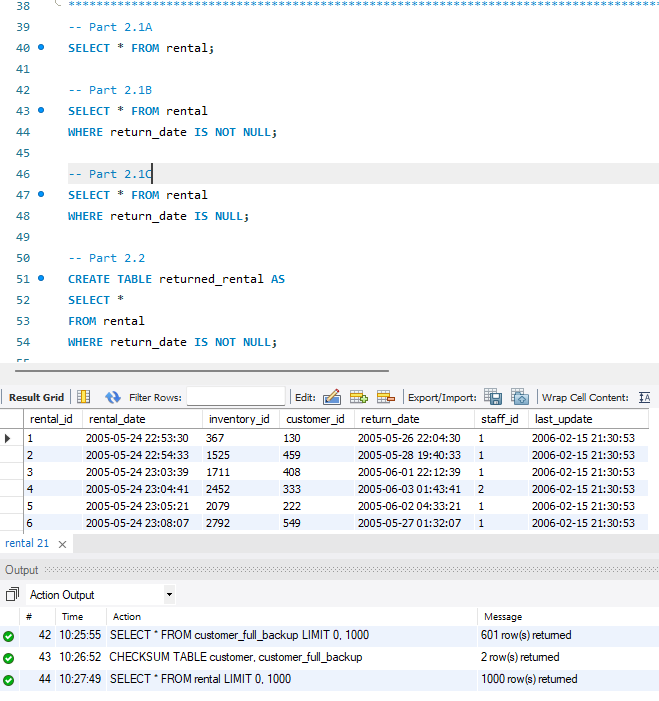

# MySQL_Chapter5
<b>Table of Content</b>
- [Summary](#summary)
- [Authors](#authors)
- [New Concepts Used](#list-of-new-concepts-used)
- [Query 1](#query-1)

## Summary
This assignment creates a testing table of the Sakila database and changes rows from it. The final query deletes the testing table. 

## List of New Concepts Used 
- Creating Backup Tables
- Inserting Rows
- Updating Rows
- Deleting Rows
- 
## Console output testing as images
### Query 1

### Query 2

## Authors
**Suna Aregay**  
GitHub: [@suna2km](https://github.com/suna2km)
**Faith Coufal**
Github: [@fafal80](https://github.com/fafal80)

