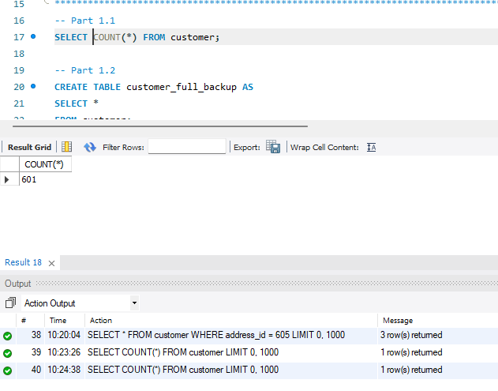
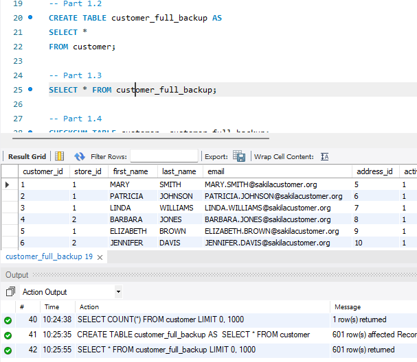
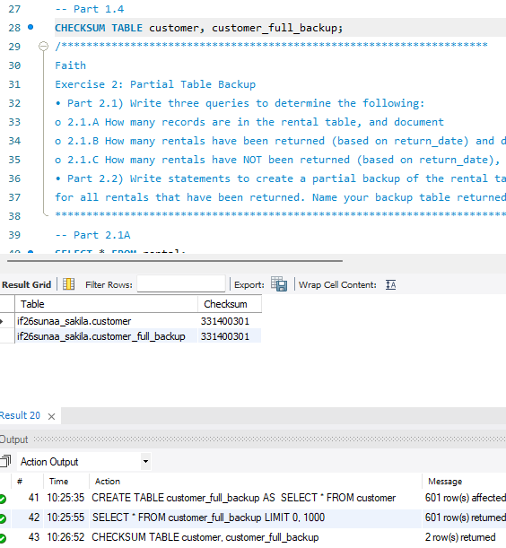
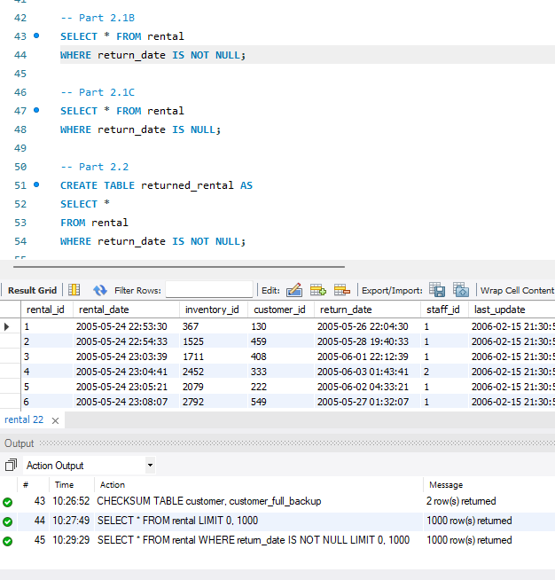
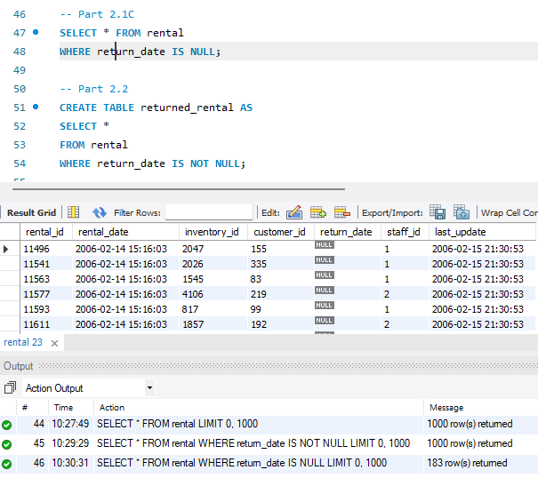
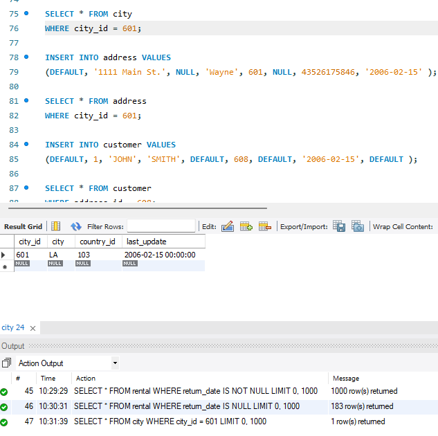
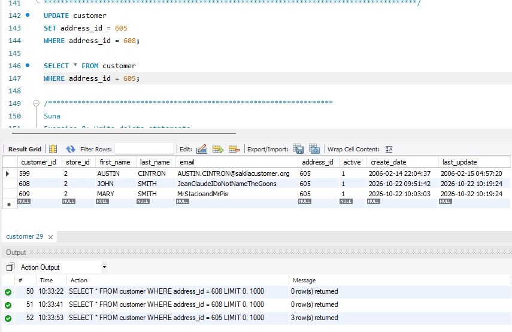
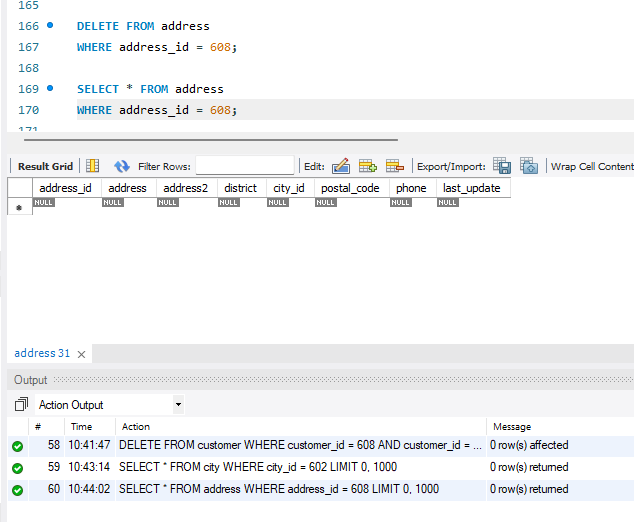
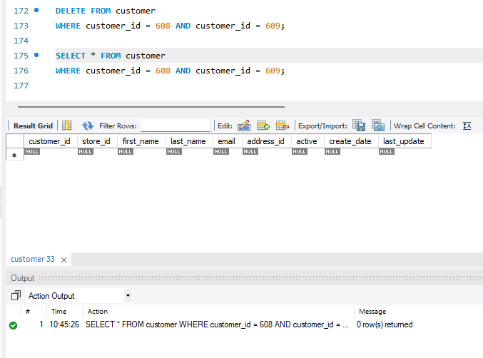

# MySQL_Chapter5
<b>Table of Content</b>
- [Summary](#summary)
- [Authors](#authors)
- [New Concepts Used](#list-of-new-concepts-used)
- [Exercise 1](#exercise-1)
- [Exercise 2](#exercise-1)
- [Exercise 7](#exercise-7)
- [Exercise 8](#exercise-8)

## Summary
This assignment creates a testing table of the Sakila database and changes rows from it. The final query deletes the testing table. 

## List of New Concepts Used 
- Creating Backup Tables
- Inserting Rows
- Updating Rows
- Deleting Rows
  
## Console output testing as images
### Exercise 1
#### Part 1.1

#### Part 1.3

#### Part 1.4

### Exercise 2
#### Part 2.1A

#### Part 2.1B

#### Part 2.1C

### Exercise 4
#### Part 4

### Exercise 7
#### Part 7

### Exercise 8
#### Part 8.1

#### Part 8.2

## Authors
**Suna Aregay**  
GitHub: [@suna2km](https://github.com/suna2km)
**Faith Coufal**
Github: [@fafal80](https://github.com/fafal80)

